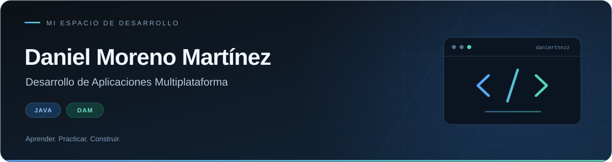

  

  <a href="#proyectos-y-prácticas">Proyectos</a> &nbsp; · &nbsp;
  <a href="#ruta-de-java">Ejercicios de Java</a> &nbsp; · &nbsp;
  <a href="https://github.com/danimrtnnzz?tab=repositories">Repositorios</a>

### Hola, soy Daniel

Estudio **Desarrollo de Aplicaciones Multiplataforma (DAM)**. En este espacio comparto mis prácticas, organizo lo que voy aprendiendo y construyo mi base en programación con **Java**.

**Mi entorno de trabajo** &nbsp; `Java` · `IntelliJ IDEA` · `Git & GitHub`

## Proyectos y prácticas

<table>
  <tr>
    <td width="50%" valign="top">
      <h3>01 · Programación con Java</h3>
      
Ejercicios de clase sobre programación estructurada: entrada de datos, condicionales, bucles, arrays y matrices.

      
<a href="https://github.com/danimrtnnzz/danimrtnnzz/tree/main/src"><strong>Explorar el código →</strong></a>

    </td>
    <td width="50%" valign="top">
      <h3>02 · Entornos de Desarrollo</h3>
      
Material de la asignatura sobre desarrollo de software. Fork del repositorio de clase, con la atribución de sus fuentes.

      
<a href="https://github.com/danimrtnnzz/IESCierva_DAM_EntornosDesarrollo"><strong>Consultar los apuntes →</strong></a>

    </td>
  </tr>
</table>

## Ruta de Java

| Tema | Qué estoy practicando | Código |
| :--- | :--- | :--- |
| **01 · Secuenciales** | Entrada de datos, operaciones y cálculos | [Ver ejercicios ↗](https://github.com/danimrtnnzz/danimrtnnzz/tree/main/src/_1secuencial) |
| **02 · Condicionales** | Comparaciones, decisiones y validaciones | [Ver ejercicios ↗](https://github.com/danimrtnnzz/danimrtnnzz/tree/main/src/_2condicionales) |
| **03 · Bucles** | Repeticiones, recorridos y bucles anidados | [Ver ejercicios ↗](https://github.com/danimrtnnzz/danimrtnnzz/tree/main/src/_3Bucles) |
| **04 · Arrays y matrices** | Colecciones de datos y tablas bidimensionales | [Ver ejercicios ↗](https://github.com/danimrtnnzz/danimrtnnzz/tree/main/src/_4Arrays) |

### Mi siguiente paso

Seguir practicando Java, entender la lógica de cada solución y mejorar la claridad de mi código.

---

Aprender. Practicar. Construir.

